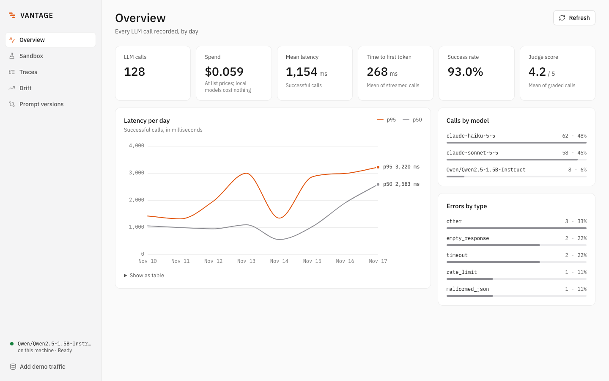
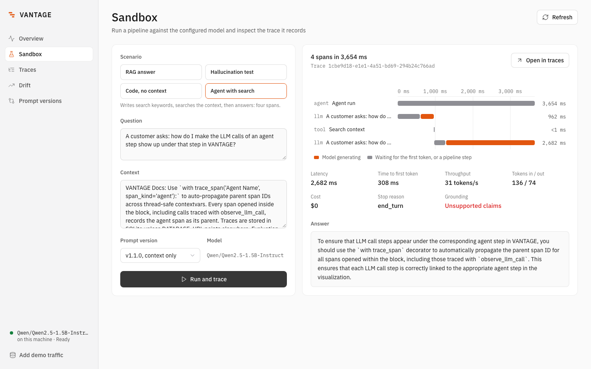
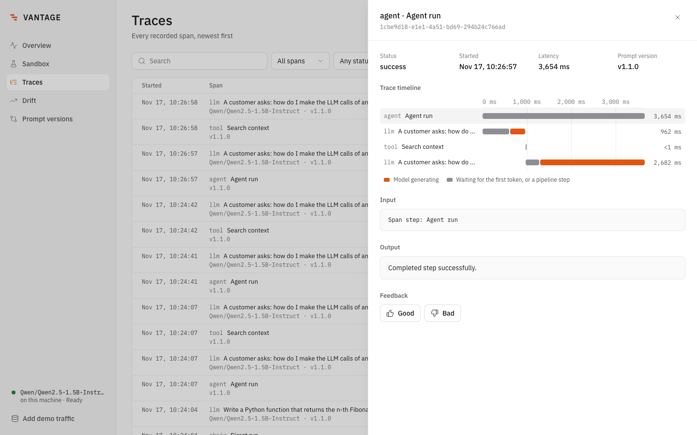
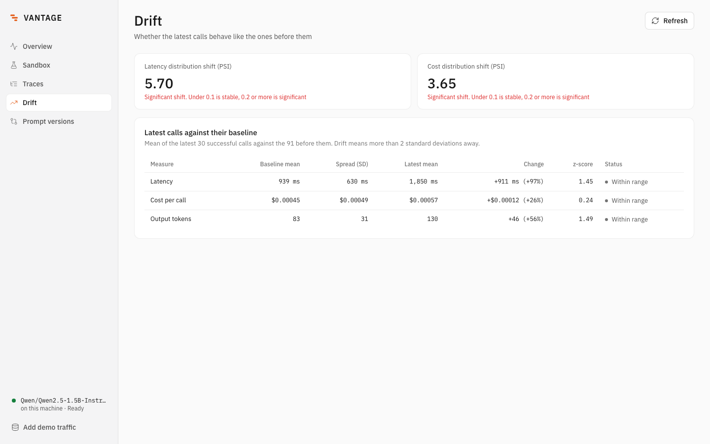
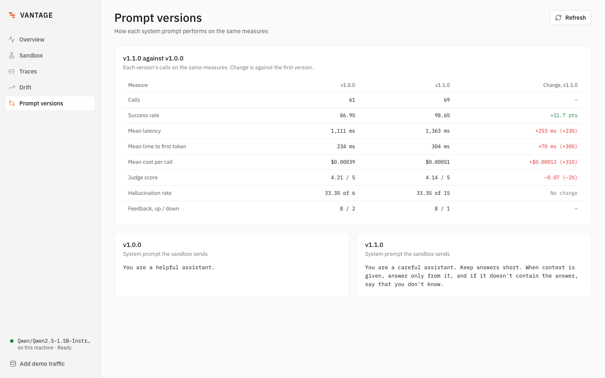
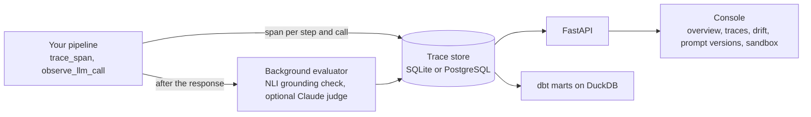

# VANTAGE LLM Telemetry & Observability Platform

VANTAGE is a tracing layer and console for LLM pipelines. It records every model call and pipeline step as a span in a trace tree, with its start time, latency, time to first token, token usage, cost, stop reason and error type. After each response returns, it checks the answer against the RAG context it was given. The console turns that telemetry into latency percentiles, drift alerts and prompt-version comparisons.

It runs entirely on your machine: the sandbox traces an open model running locally (Qwen2.5-1.5B), so every number in the console comes from a real call, with no API key and no cost. Claude is an optional backend.

---

## Console



| Sandbox | Trace timeline |
| --- | --- |
|  |  |

| Drift | Prompt versions |
| --- | --- |
|  |  |

---

## What a span records

| Field | Recorded |
| --- | --- |
| `timestamp`, `latency_ms` | When the span started, and how long it took |
| `parent_id` | The span it ran inside, set automatically through `contextvars` |
| `ttft_ms` | Time to the first text token (streamed calls) |
| `input_tokens`, `output_tokens`, `cost` | Usage from the response, priced at list prices; local models cost nothing |
| `stop_reason` | `end_turn`, `max_tokens`, `refusal`, ... so truncated and refused answers are visible |
| `status`, `error_type` | `timeout`, `rate_limit`, `empty_response`, `malformed_json`, `refusal`, `cancelled` (the caller stopped reading a stream) |
| `prompt_version` | The prompt release the call used, for the A/B view |
| `hallucination_flag` | Set by the grounding check when the call had RAG context |
| `judge_*` | Coherence, relevance and overall scores, from a Claude judge (with `LLM_PROVIDER=claude`) |
| `user_feedback` | Thumbs up or down, from the console |

Evaluation runs on a background thread after the response has been returned, so it never adds latency to the traced call. Telemetry never breaks the traced application either: a span that can't be stored is logged, not raised.

## Instrument your own pipeline

`observe_llm_call` wraps `client.messages.create` of any client shaped like the Anthropic Messages API, and `trace_span` makes every span opened inside it a child:

```python
from vantage.core.instrumentation import observe_llm_call, trace_span
from vantage.local.llm import LocalChatClient

MODEL = "Qwen/Qwen2.5-1.5B-Instruct"
client = LocalChatClient(MODEL)  # or anthropic.Anthropic(), with a Claude model

with trace_span("Answer a ticket", span_kind="agent", prompt_version="v1.1.0"):
    with trace_span("Search docs", span_kind="tool", prompt_version="v1.1.0") as step:
        docs = search(question)  # your retrieval
        step.output = f"{len(docs)} characters of context"
    messages = [{"role": "user", "content": f"Context:\n{docs}\n\nQuestion: {question}"}]
    stream = observe_llm_call(
        client, MODEL, messages, prompt_version="v1.1.0", rag_context=docs, stream=True, max_tokens=512
    )
    for event in stream:  # every event passes through unchanged
        ...
```

With Claude, pass `anthropic.Anthropic().beta` and the model and request options you'd normally send, for example `observe_llm_call(client, "claude-opus-5-5", messages, "v1.1.0", stream=True, max_tokens=16000, betas=["server-side-fallback-2026-07-01"], fallbacks="default")`.

## How it fits together



- **Grounding check** ([`local/nli.py`](src/vantage/local/nli.py), adapted from VERITAS): the answer is split into sentences, and an NLI model (`MoritzLaurer/DeBERTa-v3-base-mnli-fever-anli`) checks each one against the context and against two-sentence windows of it. A sentence the context contradicts, or doesn't cover, flags the response. Sentences that only say what the context lacks ("I don't know") make no claim and are skipped.
- **Drift** ([`eval/drift.py`](src/vantage/eval/drift.py)): the mean latency, cost and output length of the latest 30 successful calls against every call before them (a z-score above 2 is drift), plus the Population Stability Index of the latency and cost distributions.
- **Prompt versions**: the sandbox's two system prompts differ (v1.1.0 answers only from the context and says when it doesn't know), so the comparison measures real behavior. On the hallucination test preset, v1.0.0 invented who approves exceptions and was flagged, and v1.1.0 said it didn't know (one run each with Qwen2.5-1.5B and greedy decoding, 2026-11-17).

## Measured on this machine

Apple M4 (10 cores, 16 GB), 2026-11-17. Reproduce with `python scripts/benchmark.py`.

| | |
| --- | --- |
| Tracing overhead per LLM call | 0.47 ms median, 0.60 ms p95 (almost all of it the SQLite write) |
| Tracing overhead per pipeline step | 0.43 ms median |
| PSI over 500 + 500 samples | 0.20 ms |
| Loading Qwen2.5-1.5B-Instruct on the GPU (MPS) | 7.0 s, plus 1.0 s for the NLI model |
| Time to first token, local model | 148 ms median (609 ms on the first call after loading) |
| Generation speed, local model | 31 tokens/s median |
| Grounding check of a short answer | 50 ms median |

---

## Quickstart: fully local, no keys

Python 3.10 or newer.

```bash
python -m venv .venv
source .venv/bin/activate
pip install -e ".[dev,local]"
uvicorn vantage.api.main:app --host 127.0.0.1 --port 8000
```

Open http://127.0.0.1:8000.

- **First start**: the trace store (`data/observability.db`) is created and seeded with a week of synthetic demo traffic, so the dashboards and drift detection have history. Everything in it is made up; **Add demo traffic** adds another week. Real calls from the sandbox appear next to it.
- **The models** (about 3.5 GB) download from Hugging Face once and load in the background while the console starts. After that, `HF_HUB_OFFLINE=1` keeps everything offline. Without a GPU they run on the CPU, more slowly.
- **Without the local extra** (`pip install -e ".[dev]"`), the dashboards work and the sandbox says what to install.

## Using Claude instead

```bash
pip install -e ".[claude]"
export LLM_PROVIDER=claude ANTHROPIC_API_KEY=...
```

The sandbox then traces `CHAT_MODEL` (default `claude-opus-5-5`, with server-side refusal fallbacks), and a judge on `JUDGE_MODEL` (default `claude-haiku-5-5`) grades the coherence and relevance of each response. Local mode never makes a paid call.

## Deployment

The Docker image, the Render blueprint and the AWS stack run the Claude backend, since small cloud instances don't have the memory for the local models. Without `ANTHROPIC_API_KEY` they still serve the console and its demo data.

- **Docker**: `docker compose up --build`, then http://localhost:8000. Settings come from `.env` (see [`.env.example`](.env.example)); traces live in the `vantage-data` volume.
- **Render**: [](https://render.com/deploy?repo=https://github.com/pr4deepkumar/vantage) on the free plan, using [`render.yaml`](render.yaml). The free instance's disk is temporary, so traces reset on each deploy.
- **Hugging Face Spaces**: create a Docker Space from this repository and add `app_port: 8000` to the Space's README metadata.
- **AWS** ([`terraform/`](terraform/)): ECS Fargate behind an Application Load Balancer, RDS PostgreSQL, ECR and Secrets Manager. The task reads `DATABASE_URL` and `ANTHROPIC_API_KEY` from Secrets Manager. It runs one task in public subnets and the load balancer listens on HTTP; add a certificate and an HTTPS listener before real use.

  ```bash
  cd terraform
  cp terraform.tfvars.example terraform.tfvars   # set db_password and anthropic_api_key
  terraform init && terraform apply
  docker build --platform linux/amd64 -t vantage-app:latest ..
  docker tag vantage-app:latest "$(terraform output -raw ecr_repository_url):latest"
  docker push "$(terraform output -raw ecr_repository_url):latest"
  ```

## Analytics marts (dbt)

```bash
pip install -e ".[dbt]"
cd dbt && dbt build --profiles-dir .
```

DuckDB reads the trace store read-only through its SQLite extension and writes five marts to `data/warehouse.duckdb`: `stg_spans`, `fct_llm_traces` (one row per trace, with model and quality from its LLM spans), `dim_prompt_performance`, `fct_drift_baselines` and `fct_daily_llm_spend`, with `dbt test` checks.

## Configuration

Environment variables, or entries in `.env`:

| Variable | Default | |
| --- | --- | --- |
| `DATABASE_URL` | `sqlite:///data/observability.db` | Trace store. PostgreSQL needs `pip install -e ".[postgres]"` and a `postgresql+psycopg://` URL |
| `LLM_PROVIDER` | `local` | The model the sandbox calls: `local` or `claude` |
| `LOCAL_LLM_MODEL` | `Qwen/Qwen2.5-1.5B-Instruct` | Hugging Face id of the local chat model |
| `LOCAL_NLI_MODEL` | `MoritzLaurer/DeBERTa-v3-base-mnli-fever-anli` | Hugging Face id of the grounding checker |
| `LOCAL_DEVICE` | `auto` | `auto` (CUDA, then Apple MPS, then CPU), `cuda`, `mps` or `cpu` |
| `LOCAL_MAX_NEW_TOKENS` | `512` | Longest local answer |
| `ANTHROPIC_API_KEY` | | Needed for `LLM_PROVIDER=claude` |
| `CHAT_MODEL` | `claude-opus-5-5` | Model the sandbox traces with Claude |
| `JUDGE_MODEL` | `claude-haiku-5-5` | Model that grades responses with Claude |

## Tests

```bash
pytest                                  # no network, models or API keys needed
node --test tests/ui                    # the console's helpers (Node 18+)
ruff check . && ruff format --check .
```

## Limitations

- The grounding check is a signal, not a verdict. NLI models miss some paraphrases, so a correct sentence is sometimes flagged, and the flag is one yes or no per response.
- Costs use Anthropic list prices as of 2026-11-03 ([`instrumentation.py`](src/vantage/core/instrumentation.py)); long-prompt price tiers and prompt-caching discounts aren't modeled, and an unknown model is recorded without a cost.
- The dbt marts roll traces up two levels: a root span and its direct children.
- SQLite suits one machine. Use PostgreSQL for several app instances.

## License

This project is licensed under the MIT License - see the [LICENSE](LICENSE) file for details.
